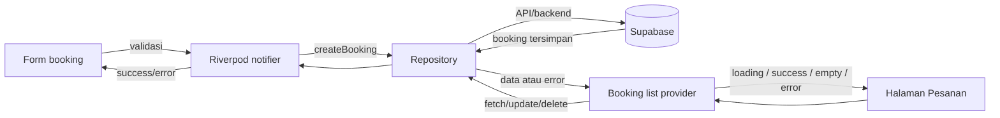

# MVP: Integrasi API dan vertical slice Booking

## Tujuan

Hubungkan satu alur inti JasaDekat dari UI ke backend: customer membuat booking jasa, lalu membaca dan mengelola booking dari halaman **Pesanan**. Data booking harus tersimpan dan dibaca dari backend, bukan hanya dari penyimpanan lokal perangkat.

## Kondisi proyek saat ini

- Fitur yang dipilih: **Booking/Pesanan**. Form booking, daftar booking, perubahan status, dan hapus booking sudah ada.
- Model: `lib/features/booking/domain/booking_request.dart`.
- Kontrak repository dan implementasi saat ini: `lib/features/services/data/service_repository.dart`.
- UI: `lib/features/booking/presentation/booking_page.dart` dan `booking_list_page.dart`.
- State async menggunakan Riverpod.
- `DemoServiceRepository` sekarang menyimpan booking ke `shared_preferences`. Service listing memakai data demo statis.
- **API/backend belum terhubung.** Dokumen arsitektur merencanakan Supabase, tetapi dependency, konfigurasi, dan implementasi Supabase belum ada di `pubspec.yaml`/source saat ini.

## Ruang lingkup MVP

### Termasuk

1. Pertahankan model dan kontrak repository sebagai batas antara UI dan sumber data.
2. Tambahkan implementasi repository backend untuk booking: ambil daftar, buat, ubah status, dan hapus.
3. Hubungkan provider/notifier pada layar booking agar operasi baca dan tulis melewati repository backend.
4. Tampilkan state loading, success, empty, dan error. Pada error baca, sediakan tombol **Coba lagi** yang mengulang fetch. Pada submit booking, tampilkan proses loading, cegah submit ganda, dan tampilkan hasil sukses atau error.
5. Validasi dan parsing model dilakukan sebelum data API ditampilkan sebagai model domain.
6. Tambahkan unit test minimum yang dirinci di bawah.

### Di luar cakupan

Chat, pembayaran, notifikasi, review, sinkronisasi offline, dan migrasi seluruh data lokal lama. Data lokal yang sudah ada tidak otomatis dipindahkan ke backend dalam MVP ini.

## Backend dan kontrak data

Target backend mengikuti rencana proyek: **Supabase + PostgreSQL**. Gunakan tabel `bookings` yang telah direncanakan pada `arsitektur.md`, dengan mapping domain yang eksplisit:

| Domain `BookingRequest` | Kolom backend |
| --- | --- |
| `id` | `id` |
| `serviceId` | `service_id` |
| `customerName` | identitas/nama customer sesuai skema backend |
| `scheduledAt` | `scheduled_at` |
| `note` | `note` |
| `status` | `status` |
| `createdAt` | `created_at` |

Skema aktual perlu disepakati dengan migration backend. Dokumen arsitektur menyebut `customer_id` dan `provider_id`, sedangkan model lokal saat ini memakai `customerName`; jangan mengasumsikan nama customer sebagai pengganti identitas autentikasi. Backend harus menetapkan relasi user dan policy RLS sebelum integrasi dianggap siap dipakai.

Operasi repository yang diperlukan:

- `fetchBookings()` — baca booking milik user yang terautentikasi.
- `createBooking(request)` — simpan booking dan kembalikan hasil backend.
- `updateBooking(request)` — ubah data/status yang diizinkan.
- `deleteBooking(id)` — hapus booking sesuai policy.

Widget tidak memanggil Supabase/HTTP secara langsung. Provider/notifier memanggil `ServiceRepository`; implementasi backend menangani transport, mapping JSON, dan menerjemahkan respons gagal menjadi error repository yang dapat ditampilkan UI. Repository demo dapat dipertahankan untuk fixture/test atau preview lokal, tetapi konfigurasi aplikasi untuk slice MVP harus memakai repository backend.

## Alur vertical slice



### Perilaku UI

| Keadaan | Perilaku yang diharapkan |
| --- | --- |
| Loading | Spinner/skeleton saat daftar diambil; tombol submit menunjukkan loading dan dinonaktifkan. |
| Success | Daftar booking tampil dari respons backend; setelah create/update/delete, UI diperbarui berdasarkan respons atau fetch ulang. |
| Empty | Pesan bahwa belum ada pesanan, dengan tindakan untuk kembali mencari/memesan jasa. |
| Error | Pesan yang mudah dipahami tanpa membocorkan credential atau detail sensitif. |
| Retry | Tombol **Coba lagi** menjalankan ulang fetch melalui notifier/repository. Error submit memberi cara mencoba lagi tanpa menggandakan request saat proses aktif. |

## Pengujian unit minimum

Sediakan setidaknya enam unit test terisolasi dari jaringan nyata. Gunakan fake/mock transport atau repository dan respons fixture agar hasil deterministik.

| # | Kasus | Hasil yang diperiksa |
| --- | --- | --- |
| 1 | Model valid | JSON booking valid berhasil dipetakan ke model; tanggal dan field sesuai. |
| 2 | Model invalid | Field wajib hilang/salah tipe atau tanggal tidak valid menghasilkan kegagalan parsing/validasi yang jelas. |
| 3 | API sukses | Respons sukses dipetakan ke model; operasi create mengirim payload yang benar dan mengembalikan booking. |
| 4 | Data kosong | Respons daftar kosong menghasilkan list kosong, bukan exception. |
| 5 | HTTP/backend gagal | Status gagal atau exception transport diterjemahkan menjadi error repository yang dapat ditangani UI. |
| 6 | JSON rusak | Body JSON tidak valid atau bentuk respons salah menghasilkan error parsing yang terkontrol. |

Nama test disarankan menggambarkan kasus, misalnya `parses valid booking`, `rejects invalid booking`, `fetches bookings on success`, `returns empty list`, `maps backend failure`, dan `rejects malformed JSON`.

## Kriteria selesai / checklist reviewer

- [ ] Ada koneksi backend/API yang benar-benar dipakai oleh alur booking.
- [ ] UI membaca dan menulis booking melalui provider/notifier dan repository; tidak mengakses API langsung.
- [ ] Data yang tampil berasal dari backend, dan create/update/delete dipersistenkan ke backend.
- [ ] Loading, success, empty, error, dan retry dapat diamati pada UI.
- [ ] Validasi model dan error parsing/transport ditangani.
- [ ] Minimal enam unit test di atas tersedia dan lulus.
- [ ] Konfigurasi endpoint/credential memakai environment/build configuration; secret service-role tidak ditanam di aplikasi.
- [ ] RLS membatasi akses booking sesuai user dan relasi booking.

## Lokasi implementasi yang relevan

- `lib/features/booking/domain/booking_request.dart`
- `lib/features/services/data/service_repository.dart`
- `lib/features/booking/application/booking_submit_provider.dart`
- `lib/features/services/application/service_providers.dart`
- `lib/features/booking/presentation/booking_page.dart`
- `lib/features/booking/presentation/booking_list_page.dart`
- `test/features/booking/` dan `test/features/services/`

## Menjalankan verifikasi

Setelah integrasi diimplementasikan, jalankan:

```sh
flutter test
flutter analyze
```

Untuk verifikasi backend end-to-end, siapkan project Supabase, migration/schema, URL dan anon key pada konfigurasi lokal, serta RLS yang sesuai. Unit test tidak boleh bergantung pada kredensial atau koneksi Supabase aktif.
